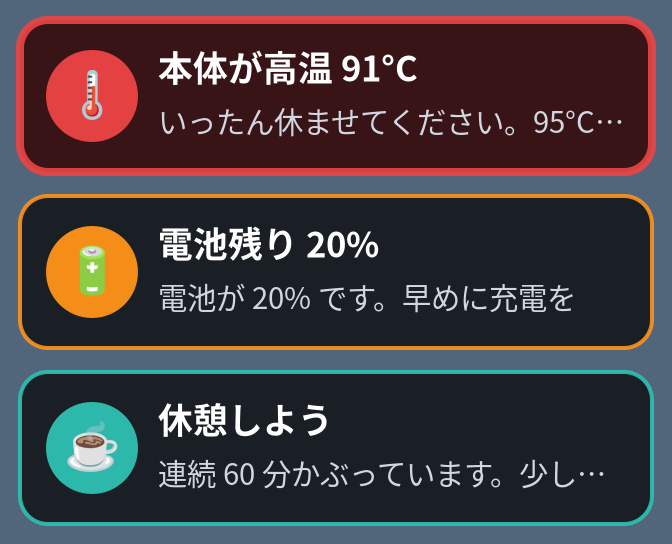

# frame-care

Steam Frame をかぶっている間、**1 時間ごとの休憩・電池の残り・本体の熱さ・充電完了** を、視界の正面に小さなカードでそっと知らせます。
夢中になっていても、目の疲れや電池切れ、熱による強制終了に気づけます。



色の意味: 赤 = 急ぎ（少し長めに出ます）、オレンジ = 注意、青緑 = お知らせ。

ほかのアプリは要りません。SteamVR を起動しているときだけカードを出します（frame-care が SteamVR を起動することはありません）。

## インストール

Frame のデスクトップモードで Konsole を開き、貼り付けて Enter:

```sh
curl -fsSL https://raw.githubusercontent.com/cympfh/frame-care/main/install.sh | bash
```

## オン・オフ

```sh
systemctl --user enable --now frame-care    # オン（次からは SteamVR と一緒に起動）
systemctl --user disable --now frame-care   # オフ
```

SteamVR を起動した状態で `python3 ~/.local/opt/frame-care/frame-care.py --test-toast` を実行すると、テストのカードが 1 枚出ます。

## 知らせること（最初の設定）

| いつ | 内容 |
|---|---|
| SteamVR を 60 分続けて使ったとき | 休憩しよう（5 分以上外すとカウントし直し） |
| 電池が 20%、10% になったとき | 電池の残り |
| 本体が 85 °C、90 °C を超えたとき | 熱さの注意（90 °C 以上は 3 分おきにくり返す） |
| 充電が終わったとき | 充電完了 |
| 水分補給（最初はオフ） | 45 分ごとに一口どうぞ |

時間や温度、夜中は知らせない「静かな時間」は、設定ファイル `~/.config/frame-care/config.json` で変えられます。

## アンインストール

```sh
curl -fsSL https://raw.githubusercontent.com/cympfh/frame-care/main/install.sh | bash -s -- --uninstall
```

外したファイルは消さずに `~/.local/share/frame-care-uninstalled/` へ移します。設定ファイルは残ります。

<details>
<summary>くわしい情報（設定・開発者向け）</summary>

- 困ったとき: `python3 ~/.local/opt/frame-care/frame-care.py --status`（問題があるときだけ書きます。`-v` でいまの値も）
- ログ: `journalctl --user -u frame-care -f`（出せなかったカードとエラーだけ書きます）
- 静かな時間でも、90 °C 以上と電池 10% 以下は知らせます。それ以外は 20 秒に 1 回・1 時間 12 回まで
- 「かぶっている時間」は、最初は SteamVR が動いている時間で数えます（近接センサーも選べます）
- sudo は使いません。カードを出す部品はインストールのときに Frame の上でビルドします
- 設定の項目と仕組み: [docs/DEVELOPMENT.md](docs/DEVELOPMENT.md)

</details>

ほかの Steam Frame 用ツール: [frame-tools](https://github.com/cympfh/frame-tools)
